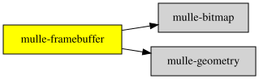

# mulle-frame

#### 💺 mulle-frame combines mulle-geometry with mulle-bitmap

The process of transforming drawing code into bitmaps is called "rasterization".
Whenever the drawing changes, the bitmap has to be updated. This update is
called a "frame". The bitmap which is drawn to, is conventionally called
the "framebuffer".

In MulleUI you don't have direct access to the framebuffer, as its on the
GPU (usually), but you can read pixels from it.

This library forms the relationship between mulle-geometry and mulle-bitmap
and introduces the frame as a concept. This is abstract though, it doesn't
provide access to actual Operating System framebuffers. That's the job of the
window libraries of MulleUI.


| Release Version                                       | Release Notes  | AI Documentation
|-------------------------------------------------------|----------------|---------------
|  [](//github.com/mulle-gfx/mulle-frame/actions) | [RELEASENOTES](RELEASENOTES.md) | [DeepWiki for mulle-frame](https://deepwiki.com/mulle-gfx/mulle-frame)


## Documentation & Guides

* [API Summary](asset/dox/api/toc)
* [Coder Guide](asset/howto/coder/mulle-frame)

## Usage

Describe a window once, in logical points, and derive the framebuffer size
in pixels (e.g. for retina displays):

``` c
#include <mulle-frame/mulle-frame.h>

int  main( void)
{
   struct CGFrameInfo  frame = CGFrameInfoSFMake( CGRectMake( 0, 0, 640, 360),
                                                  CGPixelSizeMake( 1280, 720),
                                                  2.0);

   printf( "frame  %g x %g\n",
           CGFrameInfoGetFrameSize( &frame).width,
           CGFrameInfoGetFrameSize( &frame).height);
   printf( "pixels %ld x %ld (pixelRatio %.2f)\n",
           CGFrameInfoGetFramebufferSize( &frame).width,
           CGFrameInfoGetFramebufferSize( &frame).height,
           CGWindowInfoGetPixelRatio( &frame.window));
   return( 0);
}
```

`pixelRatio` is derived as `framebuffer / frame`, so a 640x360 window on a
retina display is backed by 1280x720 pixels.


### You are here




## Add

**This project is a component of the [mulle-gfx](//github.com/mulle-gfx/mulle-gfx) library.
As such you usually will *not* add or install it individually, unless you
specifically do not want to link against `mulle-gfx`.**


### Add as an individual component

Use [mulle-sde](//github.com/mulle-sde) to add mulle-frame to your project:

``` sh
mulle-sde add github:mulle-gfx/mulle-frame
```

To only add the sources of mulle-frame with dependency
sources use [clib](https://github.com/clibs/clib):


``` sh
clib install --out src/mulle-gfx mulle-gfx/mulle-frame
```

Add `-isystem src/mulle-gfx` to your `CFLAGS` and compile all the sources that were downloaded with your project.


## Install

### Install with mulle-sde

Use [mulle-sde](//github.com/mulle-sde) to build and install mulle-frame and all dependencies:

``` sh
mulle-sde install --prefix /usr/local \
   https://github.com/mulle-gfx/mulle-frame/archive/latest.tar.gz
```

### Manual Installation

Install the requirements:

| Requirements                                 | Description
|----------------------------------------------|-----------------------
| [mulle-geometry](https://github.com/MulleUI/mulle-geometry)             | 🔭 Basic geometric types
| [mulle-bitmap](https://github.com/MulleUI/mulle-bitmap)             | 👾 mulle-bitmap describes and handles... bitmaps

Install **mulle-frame** into `/usr/local` with [cmake](https://cmake.org):

``` sh
cmake -B build \
      -DCMAKE_INSTALL_PREFIX=/usr/local \
      -DCMAKE_PREFIX_PATH=/usr/local \
      -DCMAKE_BUILD_TYPE=Release &&
cmake --build build --config Release &&
cmake --install build --config Release
```


## Author

[Nat!](https://mulle-kybernetik.com/weblog) for Mulle kybernetiK  


